<!-- ─────────────────────────  BANNER  ───────────────────────────── -->
<picture>
    <source media="(prefers-color-scheme: dark)" srcset="./assets/banner-dark.svg" />
    <source media="(prefers-color-scheme: light)" srcset="./assets/banner-light.svg" />
    
</picture>

<p align="center">
    <a href="mailto:cs.tungthanh@gmail.com"></a>
    
    <a href="https://github.com/cs-tungthanh?tab=repositories"></a>
</p>

### 👋 About me

```go
type Engineer struct {
    Name     string
    Role     []string
    Location string
    Focus    []string
    Motto    string
}

var me = Engineer{
    Name:     "Tung Thanh",
    Role:     []string{"Software Engineer", "Solution Architect"},
    Location: "Vietnam 🇻🇳",
    Focus:    []string{"scalable backend systems", "cloud architecture on AWS"},
    Motto:    "Solve · Build · Ship",
}
```

- 🛠️ I design and build **scalable backend systems** with Go, Node.js & TypeScript on AWS.
- 🚀 Happiest when turning **complex problems** into clean, reliable solutions.
- 📚 Lifelong learner, always sharpening my craft and exploring what's next.

### 🧰 Tech stack

| Area | Tools |
| :-- | :-- |
| **Languages** |  |
| **Cloud & infra** |  |
| **Data** |  |

### 🐍 Contributions

<picture>
    <source media="(prefers-color-scheme: dark)" srcset="https://raw.githubusercontent.com/cs-tungthanh/cs-tungthanh/output/snake-dark.svg" />
    <source media="(prefers-color-scheme: light)" srcset="https://raw.githubusercontent.com/cs-tungthanh/cs-tungthanh/output/snake-light.svg" />
    
</picture>

<p align="center"><samp>Last edit ❤️ 2026</samp></p>
